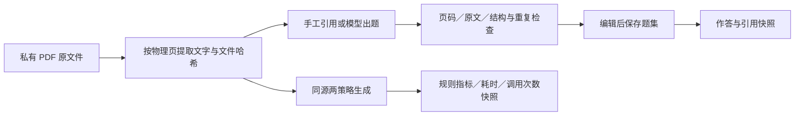

# ExamHub

从自己的资料开始，创建题集，分享练习，留下可回看的学习记录。

ExamHub 已从早期的 AI 出题表单升级为学习工作台。V2 加入私有 PDF 教材、物理页溯源与可重复评测；V3 加入有工具与持久化会话的教学教练。不配置模型也能导入教材、手工绑定原文、检查题集和练习。

## 当前功能

- 学习工作台、我的题库、公开题集广场与学习记录。
- 手工创建／编辑单选题和简答题，维护参考答案、解析与文本出处。
- 私有、链接可访问、公开三种可见性，服务端校验访问与编辑权限。
- 收藏、复制改编、题集链接分享；副本保留来源并默认私有。
- 专注练习、浏览器作答草稿、服务端客观题判分。简答题只提供参考答案供自评，不纳入自动评分。
- 提交时保存完整题目版本快照，之后作者改题或删除题集不改变历史记录。
- 访客独立身份，注册时保留访客资料；登录已有账户会合并当前访客的题集、收藏和练习记录。
- 题集 Word 导出。
- 粘贴资料后调用兼容 Chat Completions 的模型出题。后台任务可查看、取消；结果必须通过结构、答案选项、引用存在与精确重复检查，并先进入编辑器。
- PDF 教材库：原文件预览、按页提取文字、页范围生成、手工绑定引用和出处回看。
- 可解释质量检查、固定标注集检测器基准，以及两种真实生成策略的对比快照／JSON 导出。
- 教学教练：规则模式或模型选择工具的 Agent 模式，支持真实作答、理由追问、证据反馈、暂停恢复与会话导出。
- 三个原创示例题集，用于无模型体验；不提供伪造的用户量、热度、学习记录或 AI 回复。

## 本地运行

需要 Python 3.12+、Node.js 22.19+、pnpm 11+。PDF 解析工作进程使用 POSIX 资源限制，请在 macOS、Linux 或 Windows 的 WSL 中运行后端。分别启动两个终端。

后端，在仓库根目录：

```sh
python3 -m venv .venv
.venv/bin/python -m pip install -r backend/requirements.txt
cd backend
../.venv/bin/python app.py
```

后端默认监听 `http://127.0.0.1:5000`，SQLite 文件自动创建在 `backend/instance/examhub.sqlite3`。数据库和其同目录的 `documents/` 原文件目录需要一起备份；V1 数据库启动时自动兼容迁移。

前端，在仓库根目录：

```sh
cd frontend
pnpm install --frozen-lockfile
pnpm dev --host 127.0.0.1
```

打开终端显示的前端地址，通常是 `http://127.0.0.1:5173`。Vite 将 `/api` 代理到后端，所有请求使用同源 cookie。不要把两个进程各自暴露为互不信任的公开服务。

分享链接包含当前站点地址。`127.0.0.1` 链接只适合本机体验；要发给他人，需将前后端部署在可访问的同一域名下。链接可访问的题集不出现在广场，但任何持有链接的人都可以打开。

## 模型配置

在界面的“模型设置”中输入供应商接口根地址、模型名和 Key。使用支持 `/chat/completions` 的 HTTPS 接口，模型需能够根据提示返回 JSON。兼容协议不意味着所有供应商、模型及参数均已验证。

密钥只保留在服务端当前进程的用户配置中，不返回浏览器，也不进入题集／任务数据库。重启服务或退出账户后需重新配置。更换接口地址必须重新提供该供应商的 Key，防止误发已有密钥。

也可以通过环境变量提供部署默认配置。`.env.example` 是模板，程序不会自动加载 `.env`：

```sh
cp .env.example .env
# 编辑 .env 后，在启动后端的终端加载
set -a
. ./.env
set +a
cd backend
../.venv/bin/python app.py
```

可用变量：

| 变量 | 作用 |
| --- | --- |
| `AI_BASE_URL` | Chat Completions 根地址 |
| `AI_MODEL` | 模型名，按供应商实际可用型号配置 |
| `AI_API_KEY` | 可选部署默认密钥，所有访客可在限制内使用该额度 |
| `AI_ALLOWED_HOSTS` | 允许的 HTTPS 供应商域名，逗号分隔 |
| `DATABASE` | SQLite 文件绝对路径 |
| `PORT` | 后端端口，默认 5000；更改后需同步 Vite 代理 |
| `SESSION_COOKIE_SECURE` | HTTPS 部署时设为 true |

未配置 Key 时，手工出题、示例练习和题库管理照常可用。界面不会用预置题冒充模型生成。

出题每次 1–10 道，资料 20–30000 字符；每用户同时一个任务、每小时最多 10 次，实例每小时最多 60 次。格式或引用校验失败最多修复一次。取消会阻止保存结果，但已发给供应商的请求可能仍计费。服务重启后，未完成任务标记中断，可手动重新生成。

引用校验只证明引文出现在输入资料里，不证明答案正确或资料可信。生成结果请检查后保存／发布。

## V2：教材到证据，再到评测

1. 在“我的教材”上传有文字层的 PDF，检查提取文字与原文件是否一致。
2. 在阅读页选取物理页范围，进入题集编辑器。可用模型生成，也可手工编辑并在每道题的出处选择器中绑定该页原文。
3. 保存前运行质量检查。题目详情与提交后的结果能显示教材名称、物理页码与摘录，并打开对应原页。作答接口不提前下发答案或原文引用。
4. 在“评测台”运行无模型费用的固定标注集基准；配置模型后，可对同一教材／页／题量依次运行 baseline 和 grounded，生成可回看的策略报告。



**出处约束。** 引文按 Unicode NFKC 与空白折叠匹配指定页；页号、文件哈希、教材身份由服务器验证，不相信模型的“已验证”声明。公开题集只带引用摘录，原 PDF 与全文仍仅所有者可读。复制题集和历史作答保留引用快照；源文件删除后明确显示无法打开，不伪造原页。页号指 PDF 第几页，可能不同于书中印刷页码。

**质量规则。** 检查题型、答案唯一匹配选项、非空解析、引用一致性，以及规范化题干的字符三元组 Jaccard 重复候选（阈值 0.85，近似比较至少 12 字符）。每项有原因。引用存在不代表能推出答案，词面不同也可能语义重复；报告不输出未经验证的“事实正确率”。

**两类评测。**

- 固定集检测器基准：`backend/eval_fixtures.json` 是 12 个原创人工构造场景，包含规则可发现缺陷与规则无法判断的语义错误。比较 structural-v1 和 grounded-v2 的缺陷检测 precision/recall，带逐样本标签、预测、数据集 SHA256 和规则版本。它是回归集，不是独立测试集，也不代表真实教材泛化效果。可在界面查看样本并导出完整 JSON。
- 真实生成对比：baseline 做一次结构合格生成；grounded 额外检查页码和原文，失败最多修复一次。两次任务的教材、内容哈希、页范围、题量、模型、供应商及提示配置必须一致。请求编号在启动前保存，重试可找回已接受任务，同一任务对只保存一份报告。报告保留失败／取消任务，等待调用计时收尾后记录实际耗时和模型调用次数；服务重启造成的未知耗时明确显示为未知。质量指标属于规则检测，不能替代人工盲评或统计显著性检验。

**解析边界。** 单文件 20 MiB、200 页、全文 200 万字符；每次出题最多 20 页且不超过 30000 字符，不静默截断。加密／损坏／全扫描 PDF 会被明确拒绝；混合文件无文字页会提示。解析在独立子进程中执行，限制 CPU、内存和墙钟时间；生产服务还需进程级隔离、并发与磁盘配额。PDF.js 的 worker、字体与 CMap 随应用本地打包，不请求第三方 CDN。

复用：[pypdf 文本提取与限制](https://pypdf.readthedocs.io/en/stable/user/extract-text.html)（BSD-3-Clause），[PDF.js](https://mozilla.github.io/pdf.js/)（Apache-2.0）。原始库许可证以依赖包为准。

## V3：教学教练

从题集详情点击“教学教练”，或进入侧栏同名页面，选择题集、学习目标和题数。规则教练无需 Key，按顺序练习与解析；Agent 教练使用已配置的模型，按当前作答选择工具。两者在界面中明确区分。

Agent 可读取本人的当前题集历史摘要、词面检索已答题的资料摘录、选择未答题、追问理由、给出反馈或结束。选题和追问后都必须等待真实用户提交；单选按服务器保存的题目版本判分，简答与理由仅提供参考反馈。工具轨迹记录执行摘要，统计来自实际作答，不展示内部思维链或虚构掌握度。

**证据范围。** 当前检索使用中文字符二元组与英文词的重叠匹配，最多返回三条已答题附带摘录；不是跨教材语义检索。模型只能引用工具返回的证据编号，PDF 引用继续使用 V2 的可信快照并可打开原页。未来题的答案、解析与原文摘录不进入检索上下文；候选题只提供有限题干与主题描述。此边界不意味着模型不能凭已有知识推断答案，也不证明反馈事实正确。

**状态与调用。** SQLite 保存题目版本、输入轮次、真实作答、工具结果与调用统计。每个成功工具动作都形成 checkpoint；创建和作答在发送前保存请求编号，服务端按用户／会话幂等处理。版本冲突需要读取最新进度后明确操作。暂停会阻止迟到的模型结果继续推进；重启后运行中的会话暂停，部分计时明确标为不完整。历史摘要包含当前题集最近的普通练习和教学作答，不读取其他用户记录。

每轮最多 6 次模型调用，整会话最多 32 次；每用户最多 40 次／小时、实例最多 120 次／小时，调用前持久化预留额度。已问出的问题即使耗尽预算也能保存回答和判分，不再触发额外模型调用。当前单进程实例最多 8 个在途教学任务、每用户 1 个；每用户每小时最多创建 10 个会话。

**行为评测。** 页面提供原创固定场景，比较规则策略与人工编写的受控工具轨迹，检查等待用户、理由追问、引用限制、非法工具、重复问题、输出边界与停止条件。逐项显示预期、观察、失败和实际轨迹，可导出 JSON。`scripted-agent` 是测试脚本，不是真实模型得分；回归通过不能证明学习效果。离线复现：

```sh
.venv/bin/python backend/tutor_evaluation.py > tutor-benchmark.json
```

实现选型与面试证据见 [教学 Agent 设计说明](docs/architecture/teaching-agent.md)。

## 检查

```sh
cd backend
../.venv/bin/python -m unittest discover -s tests -v
```

```sh
cd frontend
pnpm test
pnpm build
```

后端测试使用临时 SQLite 数据库，不读取你的真实资料，也不调用付费模型。模型返回在外部 HTTP 边界替代，并用本地 HTTP 服务检查完整调用协议；业务校验、任务状态和数据库是真实实现。CI 执行前后端测试和前端类型检查／构建。

## 本轮边界

当前采用单进程、单机持久化部署。SQLite 数据和会话需要备份，访客清除 cookie 后无法自行恢复身份，建议注册后保存长期资料。当前没有找回密码或邮箱验证；两个已注册账户的资料不会合并。

本轮尚未实现扫描件 OCR、公式／复杂表格的专门解析、语义去重、答案事实正确性自动保证、跨题集自主课程规划、多机任务队列、完整社区审核或支付。源码没有把这些能力伪装成完成状态。公开生产部署还需要运维、身份恢复、反滥用和持久化备份等工作；当前开发服务器仅用于本地。

## 设计与开发记录

- [V3 规格](docs/superpowers/specs/2026-10-20-examhub-v3-agent.md)
- [V3 实施与验收](docs/superpowers/plans/2026-10-20-examhub-v3-agent.md)
- [V2 规格](docs/superpowers/specs/2026-10-20-examhub-v2.md)
- [V2 实施与验收](docs/superpowers/plans/2026-10-20-examhub-v2.md)
- [首版规格](docs/superpowers/specs/2026-10-20-examhub-v1.md)
- [实施计划](docs/superpowers/plans/2026-10-20-examhub-v1.md)
- [产品与竞品研究](docs/research/2026-10-20-upgrade-direction.md)
- [共享题库与 Agent 方向](docs/research/2026-10-20-examhub-and-agents.md)

旧 `/index`、`/index2` 入口会转向新工作台。旧版本曾在源码中硬编码密钥，新版已移除；如旧密钥曾有效并公开，请在供应商控制台撤销，修改源码不会清除 Git 历史中的旧值。
