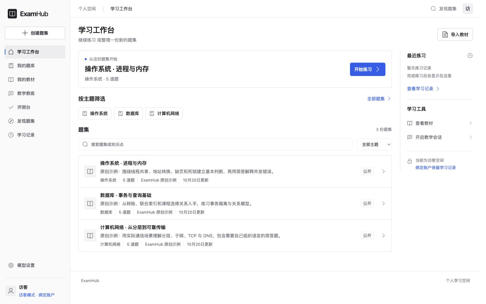
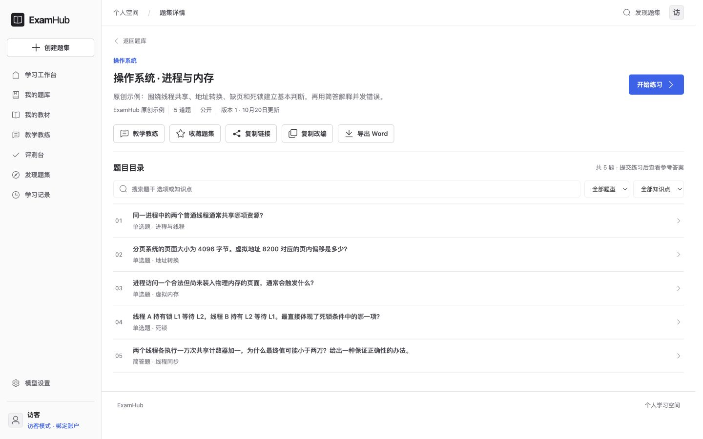
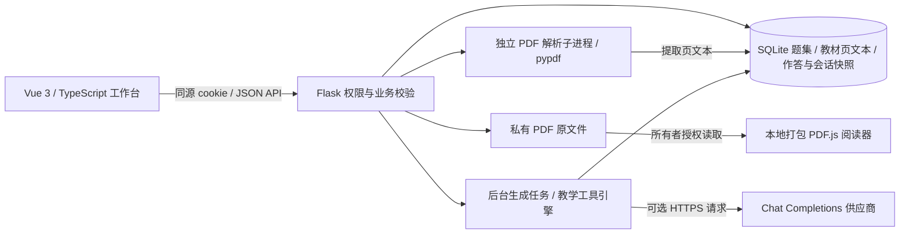

# ExamHub

从自己的教材整理题集，练习后回看答案、出处与学习记录。

ExamHub 是基于 Vue、Flask 和 SQLite 的学习工作台，支持单选题与简答题、私有 PDF 教材、题集分享、练习快照和教学教练。不配置模型也能使用示例题集、手工编辑、绑定教材原文和开启规则教练；模型出题与 Agent 教练是可选能力。

## 界面

学习工作台



题目浏览与筛选



## 快速体验，无需 Key

按下文启动前后端后，以自动创建的访客身份进入工作台：

1. 打开原创示例题集，开始练习；提交后查看客观题判分、参考答案与解析。
2. 收藏题集，或复制为自己的私有题集再编辑。学习记录保留提交时的题目版本，作者之后改题或删除题集不会改写历史。
3. 从题集进入“教学教练”，选择规则模式，体验逐题作答与反馈，模型调用数为 0。
4. 上传有文字层的 PDF，在编辑器中手工绑定页内原文，保存后查看出处卡片和原页。

示例题集不会伪装成模型生成。简答题和追问理由提供参考反馈，不纳入客观题自动判分；使用长期资料前建议注册账户。

## 本地运行

需要 Python 3.12+、Node.js 22.19+、pnpm 11+。PDF 解析子进程依赖 POSIX 资源限制，后端请运行于 macOS、Linux 或 Windows 的 WSL。

终端一，从仓库根目录启动后端：

```sh
python3.12 -m venv .venv
.venv/bin/python -m pip install -r backend/requirements.txt
cd backend
../.venv/bin/python app.py
```

后端默认监听 `http://127.0.0.1:5000`，自动创建 `backend/instance/examhub.sqlite3`。备份时需同时保存 SQLite 数据库及其同目录的 `documents/` 原文件目录。

终端二，从仓库根目录启动前端：

```sh
cd frontend
pnpm install --frozen-lockfile
pnpm dev --host 127.0.0.1
```

打开终端显示的地址，通常是 `http://127.0.0.1:5173`。Vite 将 `/api` 代理到后端；浏览器使用同源 cookie，写请求附带 `X-Requested-With: ExamHub`。更改后端端口时需同步修改 [Vite 代理](frontend/vite.config.ts)。

以上为本地开发服务。部署时需在同一站点提供前端与 `/api`，并为 Vue Router 配置页面路由回退。分享链接使用当前站点地址，`127.0.0.1` 链接只能在本机打开；发给他人前需部署到双方可访问的同一站点。

## 主要使用流程

- **查找与整理题集**：工作台、我的题库、收藏和发现题集由服务端按访问范围检索，支持关键词搜索与主题筛选，每页 12 份。题目详情支持紧凑展开、搜索、题型与知识点筛选，每页 10 题。
- **教材到题目**：上传 PDF，核对提取文字，选定物理页范围；手工编辑或用模型生成，再检查题干、答案、解析与出处。编辑器提供题目目录和每页 10 题浏览，只展开当前题，保存前验证全题集；单题集上限 100 题。生成结果先进入编辑器，经确认保存后才成为题集，也可导出 Word。
- **练习到复盘**：浏览器保存作答草稿，服务端判分并保存题目、作答和引用快照。注册保留访客资料；访客登录已有账户会合并资料与记录，两个已注册账户之间不合并。
- **教学会话**：规则模式按顺序练习；Agent 模式由模型选择读取本人历史、选题、检索已答题摘录、反馈、追问或结束。提问后等待用户真实提交，支持暂停、刷新恢复与轨迹导出。
- **检查与评测**：保存前查看带原因的质量检查；“评测台”提供固定标注集检测器基准及同条件生成策略对比，“教学教练”提供离线行为基准与需明确启动的真实模型评测。

PDF 单文件最多 20 MiB、200 个物理页、全文 200 万字符；单次生成最多选 20 页且文字不超过 30000 字符，不静默截断。加密、损坏或全扫描 PDF 会被拒绝，混合文件的无文字页会提示。页码指 PDF 物理页，可能与书中印刷页码不同。

## 架构与技术亮点



- 服务端校验题集可见性与所有者权限，作答接口隐藏答案、解析和原文；提交后保存完整版本快照，避免历史记录随源题变化。
- PDF 引用校验教材身份、文件哈希、页码与规范化原文匹配；原文件删除后明确提示无法打开。引用存在只证明摘录来自资料，不能证明答案正确。
- 教学引擎提供六个白名单工具，严格验证模型的 `{tool,args}`，每步保存 SQLite checkpoint；请求编号支持幂等重放，版本校验防止旧页面覆盖新进度，暂停后拒绝迟到动作。
- 模型调用前预留额度，记录实际调用、耗时和可获得的 token 用量；取消仍可能留下在途计费请求。教学会话与真实评测各有独立额度，不能合称跨模块总配额；重启不会自动续跑付费请求，也不承诺外部调用 exactly-once。
- 检索使用中文字符二元组和英文词的词面重叠，只检索已答题附带资料；质量检查涵盖结构、引用和近似重复候选。当前没有语义 RAG，也没有答案事实正确性保证。

前端复用 Vue Router、PDF.js、`docx` 与开源图标；后端以 Flask、SQLite 和 pypdf 承载当前单进程服务。PDF.js 的 worker、字体、CMap 和 WASM 随应用打包，不依赖第三方 CDN。工具协议、状态机与取舍详见 [教学 Agent 架构](docs/architecture/teaching-agent.md)。

## 模型配置、密钥与分享边界

在“模型设置”填写 HTTPS 接口根地址、模型名称和 Key，服务端在根地址后追加 `/chat/completions`。供应商域名必须在允许列表中，模型需能按提示返回 JSON；协议兼容不代表所有模型及参数均已验证。

个人 Key 只按用户保存在服务端当前进程内存中，不写入题集或任务数据库，也不回显到浏览器。重启服务、退出账户会清除个人临时配置；访客登录已有账户时，访客 Key 不随资料迁移。更换接口地址必须重新提供对应 Key。清除配置不会撤回已派发请求；部署默认密钥的生命周期由环境变量决定。

可选环境变量如下；不设置 `AI_API_KEY` 即可完成无模型体验。

| 变量 | 作用 |
| --- | --- |
| `AI_BASE_URL` | Chat Completions 根地址，默认 `https://api.deepseek.com/v1` |
| `AI_MODEL` | 模型名称，默认 `deepseek-flash`，实际可用性以供应商为准 |
| `AI_API_KEY` | 部署默认密钥，所有访客可在限额内使用其额度 |
| `AI_ALLOWED_HOSTS` | 允许的 HTTPS 供应商域名，逗号分隔；设置后替换默认列表 |
| `DATABASE` | SQLite 文件路径，建议使用绝对路径 |
| `PORT` | 后端端口，默认 `5000`，需与 Vite 代理一致 |
| `SESSION_COOKIE_SECURE` | HTTPS 部署设为 `true`；会话 cookie 同时使用 HttpOnly 与 SameSite=Lax |

[`.env.example`](.env.example) 只提供模板，程序不会自动读取 `.env`。需要部署默认配置时，从仓库根目录复制并编辑模板，再在启动后端的终端加载：

```sh
cp .env.example .env
# 编辑 .env 后执行
set -a
. ./.env
set +a
cd backend
../.venv/bin/python app.py
```

| 题集可见性 | 访问范围 |
| --- | --- |
| 私有 `private` | 仅所有者可读写 |
| 链接可访问 `unlisted` | 不进入公开广场，持有链接的人可读 |
| 公开 `public` | 可在发现题集中检索并打开 |

分享前请核对题目和引用摘录；有权访问题集的人可通过提交练习或复制改编取得答案与解析。原 PDF 与全文始终仅所有者可读；复制改编保留来源且默认私有。练习、教学会话与评测记录按用户隔离，分享题集不公开这些记录。访客清除 cookie 后无法自行恢复身份，目前没有邮箱验证或密码找回；若旧版本密钥曾公开，应在供应商控制台撤销，移除源码不会清除 Git 历史。

## 测试与离线复现

后端，从仓库根目录进入：

```sh
cd backend
../.venv/bin/python -m unittest discover -s tests -v
```

前端，从仓库根目录进入：

```sh
cd frontend
pnpm test
pnpm build
```

后端测试使用临时 SQLite 和模型替身，本地 HTTP 服务验证协议，不读取真实数据库或调用真实模型。前端使用 Node 内置测试设施；`pnpm build` 同时执行 `vue-tsc` 类型检查和 Vite 构建。CI 运行上述测试与构建，测试总数以当次输出为准。

以下命令均从仓库根目录执行，不需要 Key：

```sh
# 规则与人工编写工具轨迹的离线教学行为基准
.venv/bin/python backend/tutor_evaluation.py

# 按原始 content 回放已提交的复测与边界场景，保留失败
(cd backend && ../.venv/bin/python -m unittest discover -s tests -p test_tutor_recordings.py -v)

# 空白真人研究模板：零样本，均值为空
.venv/bin/python backend/tutor_study.py docs/evaluation/learning-study-template.csv
```

`scripted-agent` 是人工轨迹基线；固定标注集是开发者编写的回归集。这些结果验证程序与已定义行为，不能作为模型教学效果或真实学习收益。

## 真实模型评测与证据边界

已提交的 DeepSeek `deepseek-flash` 报告记录四个原创场景、固定学生输入，共 55 次真实调用，成功与失败均保留：

| 实测批次 | 调用数 | 实际结果 |
| --- | --- | --- |
| [首次实测](docs/evaluation/runs/2026-10-20-deepseek-smoke.json) | 20 | TCP 重复读历史、事务空检索循环，两个模型 trial 均耗尽预算 |
| [同场景复测](docs/evaluation/live-model-evaluation.md#2026-10-20-同场景真实复测) | 20 | 首次参数放错位置被拒绝；明确 JSON 参数位置后，TCP 一次、事务两次完成证据反馈、理由追问和总结 |
| [无出处与资料指令干扰](docs/evaluation/live-model-evaluation.md#2026-10-20-无出处与资料指令干扰) | 15 | 无出处首次提前结束、未达教学目标；补清提示后两次通过定义的检查，资料指令干扰两次也通过 |

规则对照的模型调用数为 0，但缺少证据检索和理由追问，不能通过全部教学目标。模型成功轨迹来自不同提示版本，最终提示尚未重新覆盖全部四场景，不能合并成总体成功率。

报告保留数据集与提示哈希、消息、输出、工具结果、耗时和供应商返回的 token 用量；含密钥或可识别思考标签的异常输出保存脱敏表示。策略遮蔽包由未参与开发的 AI 助手辅助评分，只覆盖反馈与追问片段，不含结束总结；行为完成也不代表反馈的每句话都有证据。当前没有独立真人评分或真人前后测，固定学生不会因反馈改变答案，小样本与中途提示修订均限制结论。

逐次结果、原始报告、评分附件及其限制见 [真实模型评测说明](docs/evaluation/live-model-evaluation.md)；真人研究目前只有 [协议与空白模板](docs/evaluation/learning-study.md)。重新发起界面中的真实模型评测会产生供应商调用，与上述离线回放不同。

## 未来缺口

优先固定最终提示重测全部场景、增加独立留出题与真人反馈评分，再开展真实用户试用和等价前后测。目前没有学习增益结论。

功能上仍缺扫描件 OCR、复杂公式与表格解析、语义去重、跨题集课程规划、账户找回和完整社区审核。当前为单进程与单机持久化；公开生产部署还需进程隔离、并发和磁盘配额、反滥用、备份与恢复，扩大规模后再评估任务队列和多机部署。

## 详细文档

- [前端开发入口与测试构建](frontend/README.md)
- [教学 Agent：工具、状态机、证据与工程取舍](docs/architecture/teaching-agent.md)
- [真实模型评测：全部结果、失败与评分边界](docs/evaluation/live-model-evaluation.md)
- [真人学习研究协议与 CSV 分析](docs/evaluation/learning-study.md)
- [原始运行报告](docs/evaluation/runs/)与[辅助评分附件](docs/evaluation/reviews/)
- [产品方向研究](docs/research/2026-10-20-upgrade-direction.md)与[开源方案调研](docs/research/2026-10-20-community-open-source.md)

项目由用户与 AI 编程助手协作开发。工程验证、模型行为与真实学习效果分别记录。
