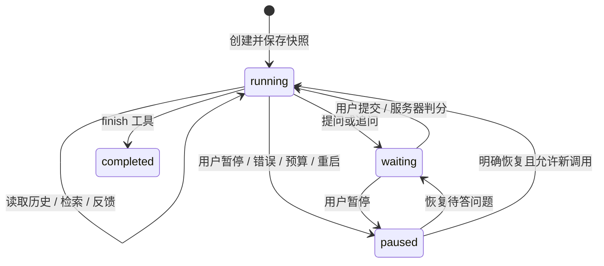

# 教学 Agent：实现取舍与可核验的求职亮点

## 用户闭环

选定题集与目标后，模型根据工具返回的事实决定下一步。它可以选择未做题、查询本人历史、查找已经作答题目的教材摘录、追问理由或结束。服务器保存每一步，等待用户真实回答；规则教练提供无需模型的顺序练习基线。

## 能在面试中讲清楚的取舍

| 能力 | 实际实现与证据 | 不应夸大的边界 |
| --- | --- | --- |
| 模型自主选工具 | `tutor_engine.py` 定义六个白名单工具；`tutor.py` 根据每次模型返回的 `{tool,args}` 验证执行，HTTP 集成测试包含先选第二题与理由追问 | 使用兼容 Chat Completions 的 JSON 动作协议，不声称原生 function calling 或多 Agent |
| 可恢复执行 | 每个动作后保存 SQLite checkpoint，等待人类输入时终止后台循环，恢复读取原快照；迟到响应不能覆盖暂停 | 单进程线程池，不是分布式 durable workflow |
| 幂等与并发 | 创建与命令保存 requestId 和输入哈希，重试返回当前同一会话；版本 CAS 防止旧页面覆盖新作答；quota 预留在 BEGIN IMMEDIATE 内 | 不承诺网络层外部模型调用 exactly-once，进程中断可能消耗一次未得到结果的调用 |
| 证据与信息边界 | 检索只作用于已答题摘录，稳定 evidenceId 引用，答案/解析来自服务器题目版本；工具权限不接收 userId/documentId | 词面重叠检索不是语义 RAG；不能用“有引用”证明推理正确 |
| 预算与观察 | 每轮/会话/用户小时/实例小时上限，实际调用前预留计数，工具摘要与耗时可导出，重启计时不完整显式标记 | 没有编造 token 费用或供应商消费金额 |
| 可重复评测 | 固定原创样本、数据集 SHA256、逐项预期/观察与轨迹，错误保留分母，规则基线暴露未实现的追问能力 | 人工脚本的通过率不是模型效果，更不是学习收益 |

没有引入 LangGraph 是本轮的工程取舍：六个小工具、已存在的 SQLite 和后台 HTTP 任务足以承载这个明确边界。迁移到多进程、长时任务或跨服务恢复时，再评估成熟队列或编排框架；当前不自行搭建通用工作流引擎。

## 可复现演示

1. 启动前后端，使用原创示例题集开启规则教练，确认模型调用数为 0。
2. 导入文字 PDF，将一条原文绑定到题目，提交回答后查看出处卡片并打开原页。
3. 配置自己的供应商后明确启动 Agent；观察它实际选择的工具，不预先承诺一定追问。暂停、刷新、恢复，核对作答和调用轨迹。
4. 在“教学行为基准”查看每个场景的预期、观察、失败和工具轨迹，或运行 `.venv/bin/python backend/tutor_evaluation.py` 导出同一报告。
5. 自动化验证：`cd backend && ../.venv/bin/python -m unittest discover -s tests -q`；`cd frontend && pnpm test && pnpm build`。真实 HTTP 替身、断网重放、权限隔离、预算边界和身份迁移均由相应测试或验收记录支持。

## 简历表达的事实边界

可以围绕“基于 Vue/Flask/SQLite 实现教材溯源与工具驱动教学会话，加入 checkpoint、请求幂等、版本校验、分层调用预算及可复现行为评测”描述工程工作。进一步写性能、模型准确率或学习效果提升前，应补真实供应商盲评、未参与开发的测试集及真实用户试用；不要把本地受控轨迹写成线上效果。

本项目由用户与 AI 编程助手协作开发。求职时需要能独立解释实现、复现测试与复盘取舍，不应将自己未参与或不理解的部分表述为独立设计成果。

## V4：真实评测补充

真实模型执行、独立数据快照、原始消息/输出、token/耗时、预算与人工复核已接入。首轮20次真实调用暴露重复历史与空检索循环，失败轨迹保留。追加20次同场景复测先暴露并保留一次参数格式错误；明确 JSON 参数位置后，TCP 一次及事务两次均完成证据反馈、理由追问和总结，未重现原循环。第三轮另获20次上限，实际使用15次：保留无出处提前结束的负例，补清提示后两次完成，资料指令干扰两次也完成。共55次实际调用，四场景的成功轨迹分属不同提示版本，不宣称最终版本总体成功率。

进度上下文、已答题关键词检索和严格工具校验沿用同一引擎；原始 content 可离线重放核对逐步返回值与最终状态。新反馈由未参与开发的 AI 助手阅读策略遮蔽包独立辅助评分，量表、实际输入、理由及执行快照哈希可核对；只评 feedback/followup 片段，不含 finish 总结。详见 [逐次结果与证据边界](../evaluation/live-model-evaluation.md)。没有独立真人评分或真人前后测数据，不能写学习提升百分比。
